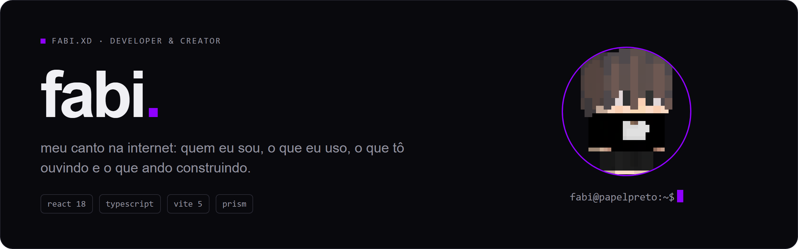

<p align="center">
  
</p>

# hello world welcome to my site!

Site pessoal do **fabi**: quem eu sou, o que eu uso, o que tô ouvindo e o que ando
construindo. No ar em [ofabiano1.github.io/fabi.xd](https://ofabiano1.github.io/fabi.xd/).

## O que tem

| seção | o que mostra |
| --- | --- |
| Home | apresentação |
| About | quem eu sou |
| Experience | por onde passei |
| Stack | o que eu uso no dia a dia |
| Spotify | as últimas que eu ouvi, atualiza a cada 30 min |
| GitHub | meu perfil e repositórios |
| Este site | como ele foi feito |
| Community | a comunidade |
| Lab | experimentos |

E uns segredos escondidos pelo caminho.

## Stack

- React 18 + TypeScript + Vite 5
- [Prism](https://github.com/OFabiano1/prism): tokens, componentes, Inter + JetBrains Mono, tema escuro e claro
- CSS puro por seção em `src/styles/`
- Lucide Icons

## Rodando

```bash
npm install
npm run dev       # localhost:5173
npm run build     # tsc --noEmit && vite build
npm run preview
```

O Vite quebra em caminho com `#` (tipo `#Projetos`). Se acontecer, roda de uma cópia em
outro lugar.

## Editar conteúdo

Tudo que muda fica em `src/data/`:

- `experience.ts`: experiência
- `stack.ts`: tecnologias
- `socials.ts`: redes e e-mail
- `github.ts`: perfil do GitHub
- `marquee.ts`: a faixa que corre
- `spotify.json`: gerado no deploy, não edita na mão

## Deploy

O `.github/workflows/deploy.yml` publica o `dist/` no GitHub Pages a cada push e a cada
30 minutos. Antes do build, o `scripts/fetch-spotify.mjs` atualiza o `spotify.json` com os
secrets `SPOTIFY_CLIENT_ID`, `SPOTIFY_CLIENT_SECRET` e `SPOTIFY_REFRESH_TOKEN`. Sem eles,
o JSON atual fica. O `vite.config.ts` usa `base: '/fabi.xd/'`.
